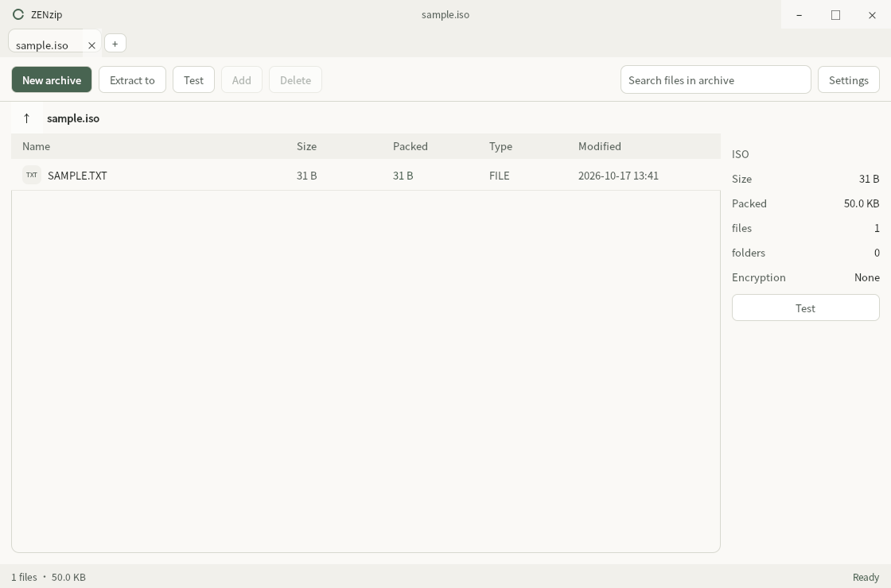

# ZENzip

[简体中文](README.zh-CN.md) | English

A quiet, cross-platform archive manager. Native 7-Zip and a simple Qt Quick interface for opening, creating and extracting archives.

**Version 0.4.1** · Windows, macOS and Linux · x64 and ARM64

[Download](https://github.com/whh110112/ZENzip/releases/tag/v0.4.1) · [Installation](native/docs/installation-guide.md) · [Known limitations](native/docs/known-limitations.md)

## A little less noise

- Tabs, a task queue, cancellation and per-file conflict choices.
- Create ZIP, 7Z, TAR and TAR.GZ; extract RAR, RAR5, ISO and WIM too.
- Encrypted archives, split volumes, ZIP64 and legacy filename encodings.
- Six quiet palettes: Paper, Ink, Sand, Slate, Mist and Bamboo. Eighteen languages, including RTL.
- Saved passwords and desktop integration. Windows uses DPAPI; macOS/Linux vault files use owner-only permissions and are **not encrypted**.

C++17, Qt 6.8.3 and 7-Zip 26.04. Runs offline without Electron or Node.js. Existing native profiles and Windows encrypted vaults remain compatible.

## 18 interface languages

Simplified Chinese (`zh-CN`), Traditional Chinese (`zh-TW`), English (`en`), Japanese (`ja`), Korean (`ko`), French (`fr`), German (`de`), Spanish (`es`), Brazilian Portuguese (`pt-BR`), Russian (`ru`), Italian (`it`), Polish (`pl`), Turkish (`tr`), Vietnamese (`vi`), Thai (`th`), Indonesian (`id`), Arabic (`ar`, right-to-left) and Hindi (`hi`). Choose a language in **Settings → Language**; changes apply immediately and are saved locally.

All 18 translation catalogs are checked for missing keys. Fonts come from the operating system; minimal Linux installations may need fonts for the chosen script. Not every translation has been reviewed by a native speaker. See the [settings and usability audit](docs/usability-audit-2026-10.md) for layout checks and remaining work.

## Before installing

Windows packages are unsigned. macOS packages are ad-hoc signed and not notarized. Linux deb requires glibc 2.39 or later; macOS requires 13 or later.

Windows uses the classic context menu, under “Show more options” on Windows 11. Modern Windows 11 menus, Finder/Nautilus extensions, SFX creation, archive repair and an auto-updater are not included. See the [feature matrix](native/docs/feature-parity.md) and [0.4.1 verification report](docs/verification-0.4.1.md) for the tested scope.

## Build and contribute

The [native workflow](.github/workflows/native-candidate.yml) pins dependencies and builds all six targets. See the [installation/build guide](native/docs/installation-guide.md). Full capture matrices belong in build artifacts; each README shows one real capture in its own language.

## License

ZENzip source is MIT. Qt, bit7z and 7-Zip have their own licenses; see [third-party notices](native/packaging/NOTICE.md).
