# REAzip

中文 | [English](README.md)

一款以完整 7-Zip 原生库为核心的跨平台压缩包管理器，提供多标签、六主题的 Qt Quick 界面。REAzip 把久经考验的 7-Zip 26.04 引擎和 Bandizip 普及的日常操作流——多标签、任务队列、智能解压、逐条目冲突处理——结合在一起，同时保持功能面诚实：界面上没有假按钮。

> **状态：0.3.0-dev 候选版本。** 已公开的 v0.2.1 是旧 Electron 版。原生版本只有在六目标完整验收通过后才会正式发布；哪些已验证、哪些未验证，见[验收报告](native/docs/acceptance-report.md)。

| 主窗口（浅色） | 新建压缩 | 解压 |
|---|---|---|
| 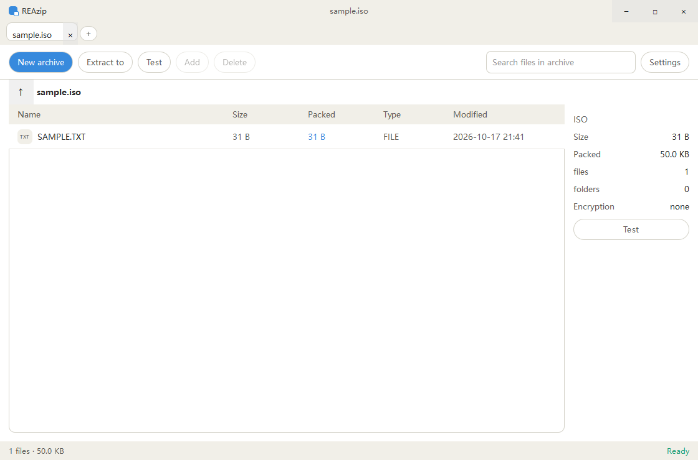 | 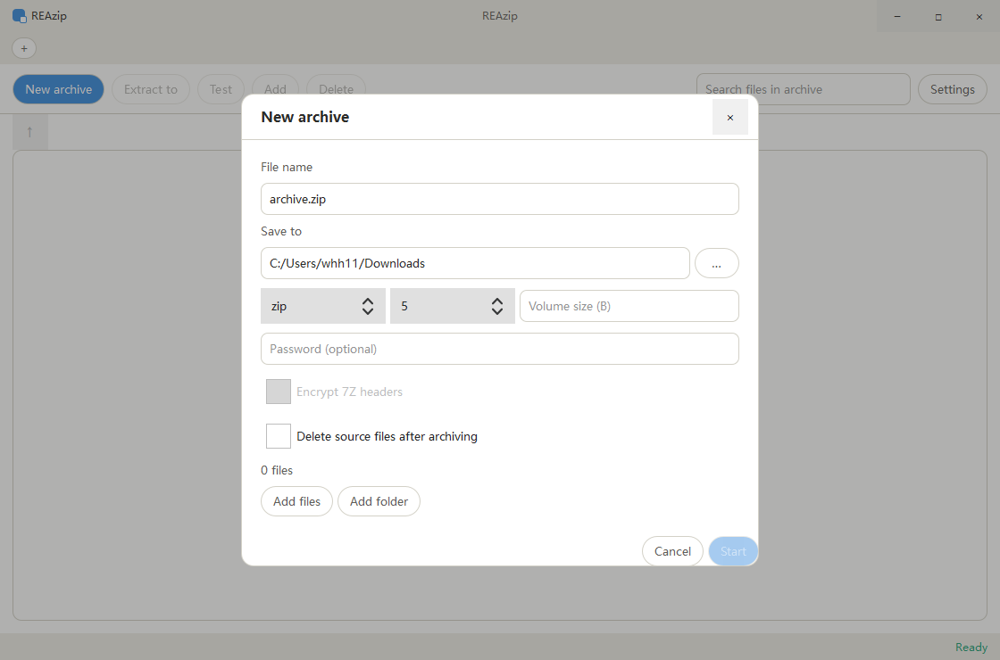 | 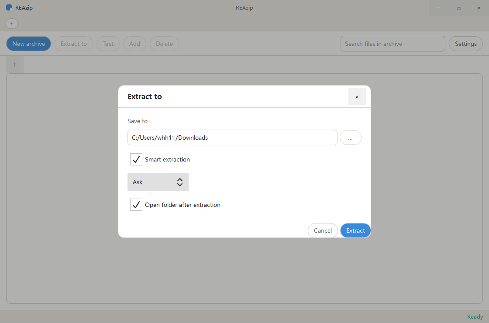 |

| 密码挑战 | 同名冲突 | 设置 |
|---|---|---|
| 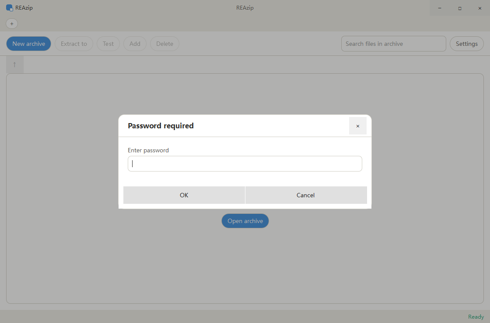 | 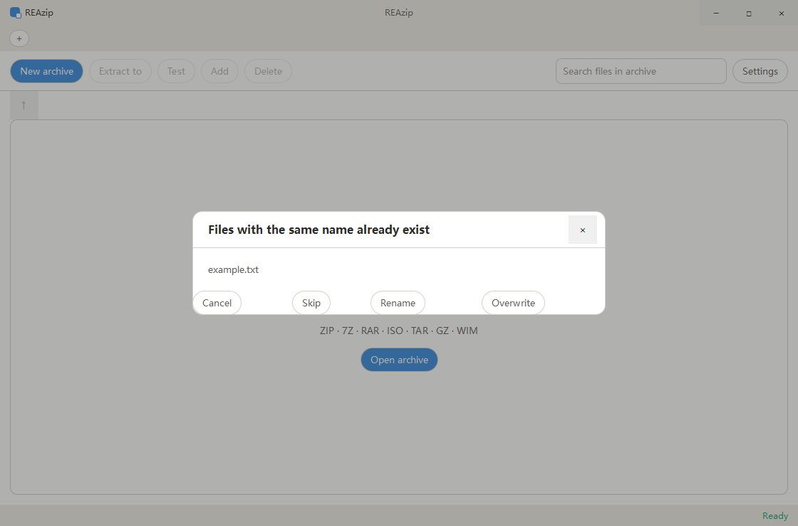 | 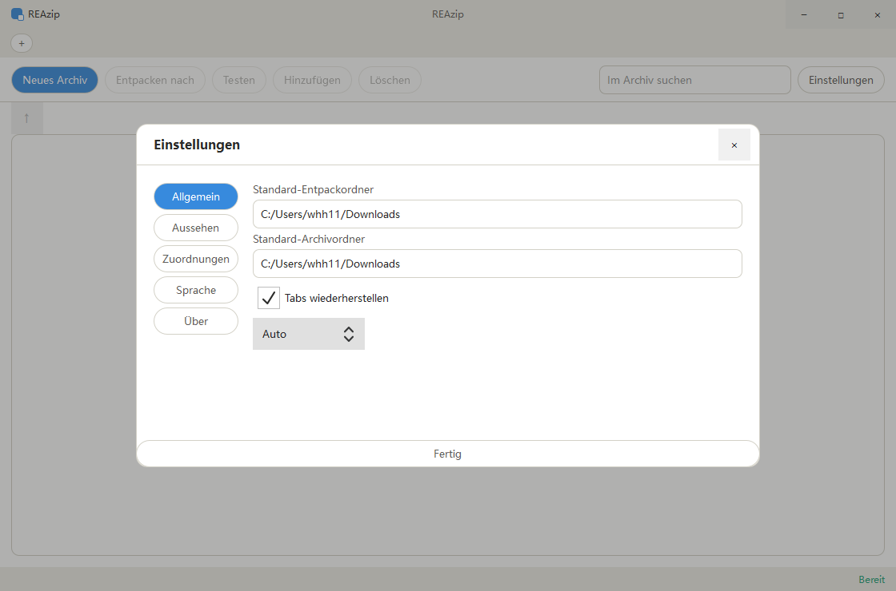 |

| Glass 主题 | macOS 深色主题 | Material 主题 | Sleep 主题 |
|---|---|---|---|
| 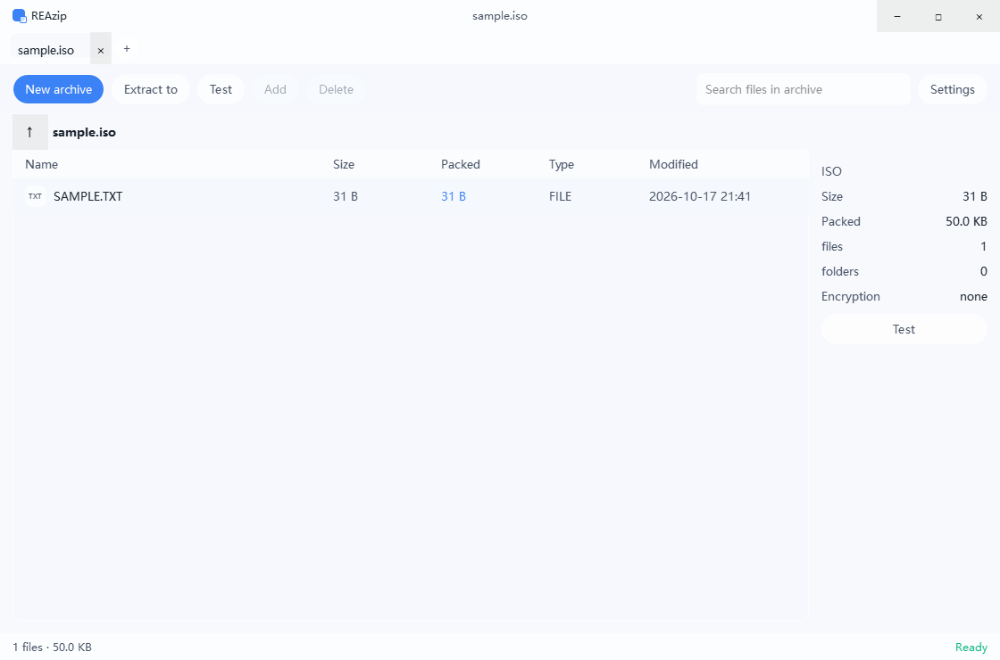 | 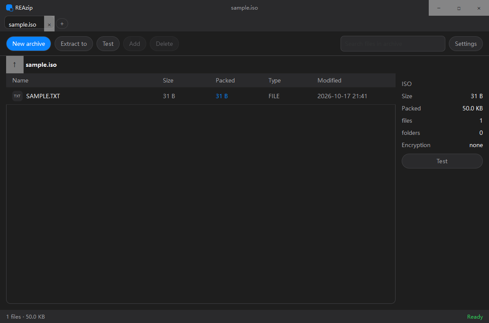 | 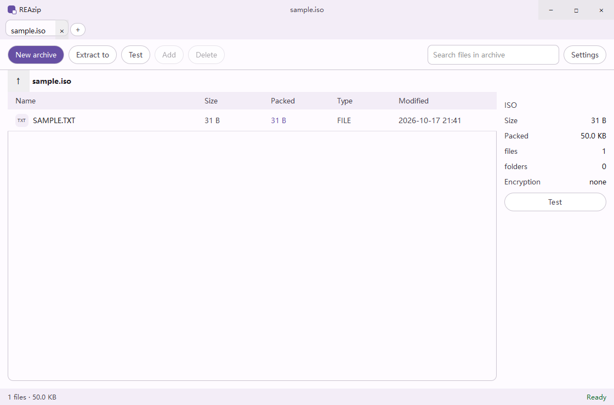 | 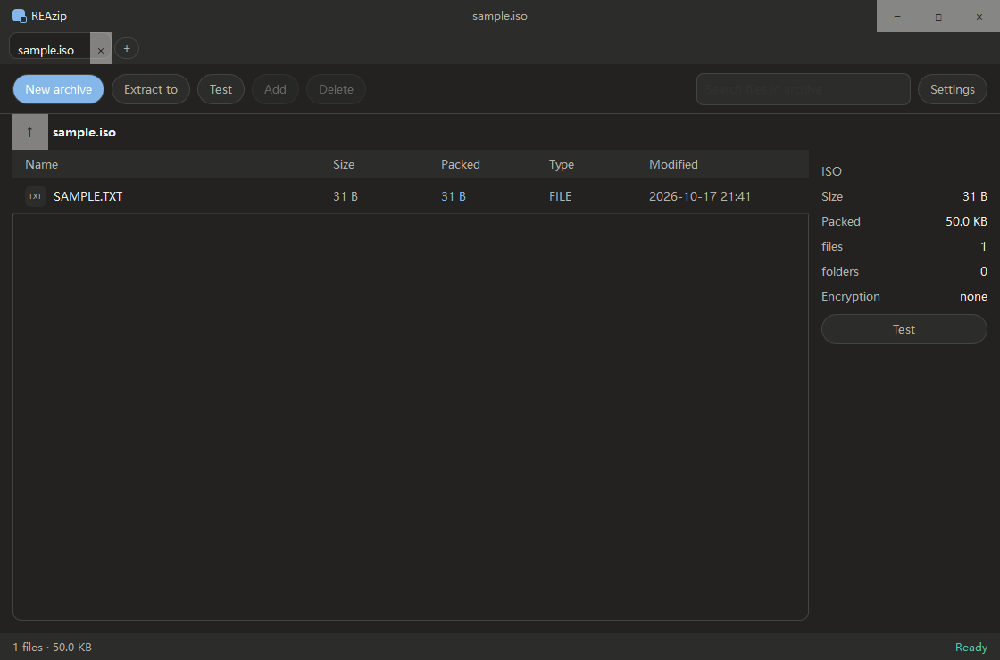 |

RTL（阿拉伯语）与简体中文预览：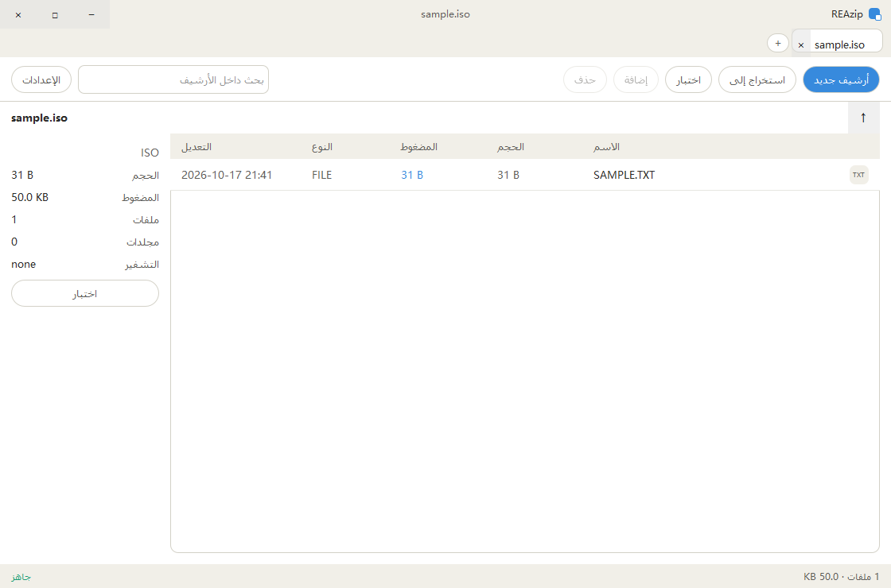 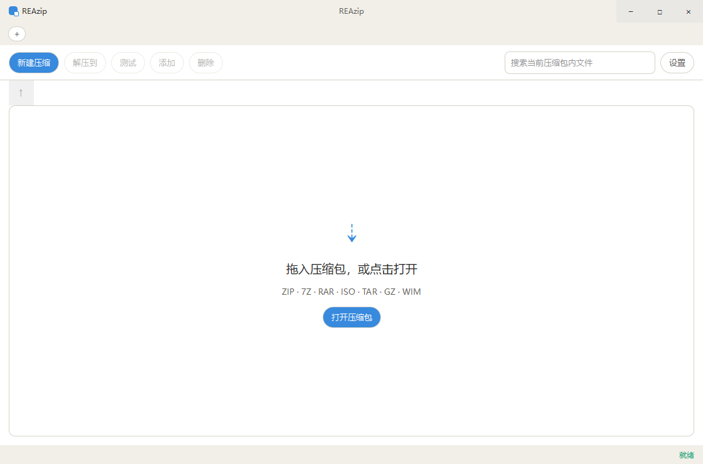

<sub>所有截图均为 0.3.0-dev 候选版以 0.5 缩放运行时的真实抓图，每张的 SHA-256 记录在 [`native/design/native-reference/manifest.json`](native/design/native-reference/manifest.json)。它们拍摄于本次设置页布局修复之前，因此设置/外观两张仍是旧的底部按钮对齐方式，将于下一个通过验收的构建重新抓取。</sub>

## 特性

- **原生引擎，无运行时包袱** — C++17 + Qt Quick 6.8.3 + bit7z 4.1.0 + 完整 7-Zip 26.04 库。不含 Electron、Node 和内置浏览器；x64 安装包约 26 MB（v0.2.1 约 121 MB）。
- **多标签、队列、取消** — 多标签浏览、后台任务队列与真实取消；worker 独立进程隔离，压缩包异常时界面仍然存活。
- **格式覆盖** — ZIP / 7Z / TAR / TAR.GZ 创建、列表、测试、解压；RAR / RAR5 / ISO / WIM 只读浏览与解压；ZIP AES-256 与旧 ZipCrypto；7z 文件头加密；分卷；超过 4 GiB 的 ZIP64。
- **旧压缩包文件名编码** — GBK / Big5 / Shift-JIS 显式解码，另有自动策略。
- **安全内建** — 解压时阻断路径逃逸、符号链接与重解析点攻击；所有写入经临时文件原子提交并带日志恢复，崩溃或磁盘满不会破坏原压缩包。
- **六主题、18 语言、完整 RTL** — 并保守迁移旧版自定义颜色 token。
- **按系统能力提供集成** — Windows 每用户关联与经典资源管理器菜单、macOS bundle 文件类型注册、Linux MIME/desktop 项；系统默认应用始终由用户决定。

## 功能对照

对比仅限公开资料与本项目自身的验收范围；“–”表示本版本未实现。

| 能力 | REAzip 0.3.0-dev | 7-Zip | NanaZip | Bandizip |
|---|---|---|---|---|
| ZIP / 7Z / TAR / GZ 创建与解压 | ✓ | ✓ | ✓ | ✓ |
| RAR / RAR5 / ISO / WIM 解压 | ✓ | ✓ | ✓ | ✓ |
| ZIP AES-256 写入、7z 文件头加密 | ✓ | ✓ | ✓ | ✓ |
| 分卷、ZIP64 > 4 GiB | ✓ | ✓ | ✓ | ✓ |
| 旧 ZIP 代码页（GBK/Big5/Shift-JIS） | ✓ | ✓ | ✓ | ✓ |
| 多标签浏览 | ✓ | – | – | ✓ |
| 任务队列与取消 | ✓ | – | – | ✓ |
| 主题 / 18 语言 / RTL | ✓ | – | 部分 | 部分 |
| 无管理员权限的每用户安装 | ✓ | ✓ | ✓ (MSIX) | ✓ |
| Win11 现代右键菜单 | – | – | ✓ | ✓ |
| SFX 创建、密码恢复、损坏修复 | – | – | – | ✓ |

## 下载

候选包（Windows x64/ARM64 安装 EXE + 便携 ZIP、macOS x64/ARM64 DMG + ZIP、Linux x64/ARM64 AppImage + tar.gz + deb）由 [native candidate workflow](https://github.com/whh110112/REAzip/actions/workflows/native-candidate.yml) 产出；每个包都附带版本、源码 SHA、CPU 架构、SHA-256、签名状态与许可声明。

- Windows 未代码签名；macOS 为 ad-hoc 签名、未公证。
- Linux deb 需要 glibc ≥ 2.39（Ubuntu 24.04 构建）；macOS 部署目标 13.0。
- 安装、便携模式与旧设置迁移见[安装指南](native/docs/installation-guide.md)。

## 从源码构建

需要 Python 3.12+、C++17 工具链、CMake 与 Ninja。依赖版本与摘要锁定在 `native/deps.lock.json`；CI workflow 是权威构建脚本。

```sh
python -m pip install aqtinstall==3.3.0 ninja==1.11.1.4 cmake==3.31.6
python native/bootstrap/dependencies.py --arch x64
python native/bootstrap/qt-sdk.py --arch x64 --output .native-build/Qt
# 将生成的 Qt SDK 加入 PATH / CMAKE_PREFIX_PATH 后：
cmake -S native -B .native-build/release -DREAZIP_ENGINE_DIR=/absolute/path/to/native/.deps/engine/x64 -DREAZIP_HEAVY_TESTS=ON
cmake --build .native-build/release --config Release --parallel 3
ctest --test-dir .native-build/release -C Release --output-on-failure
```

ARM 目标把 `x64` 换成 `arm64`（Windows ARM 还需 `QT_HOST_PATH`）。首次构建需联网下载 Qt 并编译完整 7-Zip；发行包离线运行。

## 本版本明确不做的事

Win11 现代右键菜单、Finder/Nautilus 扩展、SFX 创建、密码恢复、复杂损坏修复、密码管理器、图库预览与自动更新客户端**均未实现**，也不会以可点击的假入口出现。RAR 写入、TAR/TGZ 加密、TGZ 分卷会被明确拒绝并说明原因，不会静默忽略。完整边界见[已知限制](native/docs/known-limitations.md)与[功能对照](native/docs/feature-parity.md)。

## 许可

REAzip 自有代码采用 MIT；发行包另含 Qt（LGPL）、bit7z（MPL）、7-Zip（LGPL/unRAR 限制），**整个发行包不能简写成“全部 MIT”**。第三方声明与对应源码随包提供，见[打包声明](native/packaging/NOTICE.md)。Bandizip 为其权利人商标，本项目与其无关联。
