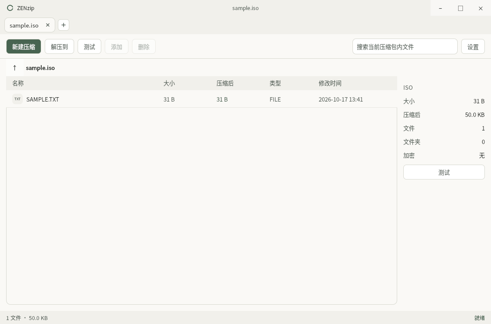

# ZENzip

简体中文 | [English](README.md)

一款安静、简洁的跨平台压缩包管理器。以原生 7-Zip 为核心，用清晰的 Qt Quick 界面完成打开、压缩与解压。

**版本 0.4.0** · Windows、macOS、Linux · x64 与 ARM64

[下载](https://github.com/whh110112/ZENzip/releases/tag/v0.4.0) · [安装指南](native/docs/installation-guide.md) · [已知限制](native/docs/known-limitations.md)

## 少一点纷扰

- 多标签、任务队列、取消操作，逐条选择同名文件的处理方式。
- 创建 ZIP、7Z、TAR 和 TAR.GZ；也能解压 RAR、RAR5、ISO 与 WIM。
- 加密压缩包、分卷、ZIP64，以及旧压缩包的文件名编码。
- 六款素雅皮肤：素纸、夜墨、砂庭、青石、薄雾、竹影。支持 18 种界面语言与 RTL。
- 常用密码保存与桌面集成。Windows 密码库由 DPAPI 加密；macOS/Linux 仅靠文件权限保护，**不加密**。

使用 C++17、Qt 6.8.3 和 7-Zip 26.04，可离线运行，无需 Electron 或 Node.js。原名 REAzip，兼容已有原生配置及 Windows 加密密码库。

## 18 种界面语言

简体中文（`zh-CN`）、繁體中文（`zh-TW`）、英语（`en`）、日语（`ja`）、韩语（`ko`）、法语（`fr`）、德语（`de`）、西班牙语（`es`）、巴西葡萄牙语（`pt-BR`）、俄语（`ru`）、意大利语（`it`）、波兰语（`pl`）、土耳其语（`tr`）、越南语（`vi`）、泰语（`th`）、印度尼西亚语（`id`）、阿拉伯语（`ar`，从右向左布局）、印地语（`hi`）。在 **设置 → 语言** 中切换，即时生效并保存在本机。

18 份翻译字典均检查缺失键；字体由操作系统提供，精简 Linux 系统可能需要补装对应语种字体。并非每种译文都经过母语者审校。布局检查与待改进项见[设置与易用性审计](docs/usability-audit-2026-10.md)。

## 安装前了解

Windows 安装包未代码签名；macOS 为 ad-hoc 签名、未公证。Linux deb 需要 glibc 2.39 或更新版本；macOS 需要 13 或更新版本。

Windows 使用经典右键菜单，在 Windows 11 中位于“显示更多选项”。本版不包含 Windows 11 现代菜单、Finder/Nautilus 扩展、自解压包创建、损坏修复和自动更新。功能边界见[功能矩阵](native/docs/feature-parity.md)，实测范围见 [0.4.0 验证报告](docs/verification-0.4.0.md)。

## 构建与参与

[原生构建流程](.github/workflows/native-candidate.yml)固定依赖版本，覆盖六个平台目标。构建说明见[指南](native/docs/installation-guide.md)。完整截图矩阵保存在构建附件中，README 各自只展示一张对应语言的真实截图。

## 许可

ZENzip 自有源码采用 MIT 许可。Qt、bit7z、7-Zip 各有其许可，详见[第三方声明](native/packaging/NOTICE.md)。
