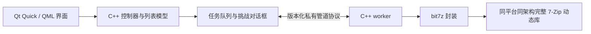

# REAzip 原生迁移：任务总览

编制日期：2026-10-17。执行模型：由用户另行选择 GPT-6.1 Sol。本文件包仅为执行任务书，没有启动实现、创建聊天、改源码或发布新版本。

## 目标与基线

- 当前源码：`D:\Workbuddy\2026-10-13-14-25-42\reazip`。
- 仓库：https://github.com/whh110112/REAzip
- 已审查基线：`163e17a411f648f8aa210356f1e3b2a006967ea4`，Electron v0.2.1。
- 保留当前界面设计、已有有效功能、6 套内置皮肤、18 种语言和用户设置；修复审查中已确认的问题。
- 目标平台：Windows x64/ARM64、macOS x64/ARM64、Linux x64/ARM64。
- 新线版本建议 0.3.0；开发阶段用开发/预发布标记，最终版本由验收阶段确定。不要移动或重建已有 v0.2.x 标签。

## 技术方案

**C++17 + Qt 6 Quick/QML + bit7z 4.1.0 候选 + 完整 7-Zip 动态库。**

Qt 的精确版本必须在 T01 验证六个平台/架构的开源工具链可获取性后锁定；7-Zip 26.04 是现版基线，T01 验证与 bit7z 的 ABI/构建兼容性后锁定版本、源码 URL、哈希和工具链。不能使用漂移的 latest/master 依赖。

- QML 重建现有 HTML/CSS 的视觉设计，C++ 负责业务、模型、文件系统和引擎。QML 是声明式界面文件，允许简单绑定，不是继续使用 Electron 或浏览器页面。
- Qt Quick 是原生编译应用中的渲染界面，不保证每个控件都采用操作系统原生控件。系统文件对话框、文件关联、菜单和窗口行为按平台集成。
- 归档工作放在独立 C++ worker 进程，进程内通过 bit7z 调用原生动态库。GUI 不加载不可信归档解析器。worker 分离是崩溃隔离，不代表已建立操作系统沙箱。
- 首版一个归档任务一个 worker，默认串行执行重任务；协议支持多个任务 ID，后续可安全扩展并发。
- 正常应用运行不依赖 Node、Electron、Chromium、QtWebEngine、7z.exe/7zz 命令行或 tar.exe。外部 CLI 可用于测试交叉验证，不能成为生产功能回退。
- 完整库常见为 Windows 7z.dll 和 Unix 7z.so；实际名称、位置、导出符号由 T01 验证，不能凭扩展名猜测。7za.dll 不是全格式库。
- 当前界面外观保留不等于逐字迁移 CSS。自定义主题中的颜色等变量迁移，任意 CSS 转换不能保证；必须提供明确的兼容说明和原文件备份。
- 第一轮不 fork NanaZip：借鉴其系统集成和归档交互，不把其 Windows 专用 UI 当成三平台底座。

## 分工与执行顺序

| 任务 | 产出 | 硬依赖 | 角色/可并行批次 |
|---|---|---|---|
| [T00](tasks/T00-baseline.md) | 行为、界面基线与接口确认 | 无 | 先单独完成 |
| [T01](tasks/T01-foundation.md) | CMake、公共接口、六平台引擎最小验证 | T00 | 先完成再分工 |
| [T02](tasks/T02-engine-read.md) | 原生读取、列表、格式/编码、密码入口 | T01 | 核心线 A |
| [T03](tasks/T03-engine-write.md) | 安全解压、压缩、修改、TGZ | T02 | 核心线 A 后续 |
| [T04](tasks/T04-worker-jobs.md) | worker、进度、取消、密码/冲突协议 | T01 | 后端线 B，可用假引擎先实现 |
| [T05](tasks/T05-native-ui.md) | 保留设计的 QML 界面 | T01 | 界面线 C，可用模型桩 |
| [T06](tasks/T06-integration.md) | 完整操作串联、缺口补齐 | T02、T03、T04、T05、T07、T08 | 集成负责人串行收口 |
| [T07](tasks/T07-os-integration.md) | 文件关联、系统打开、便携、系统菜单 | T01 | 系统线 D |
| [T08](tasks/T08-settings-i18n.md) | 设置迁移、皮肤、18 语言 | T01 | 可与 T02/T04 并行；与 T05 按接口接入 |
| [T09](tasks/T09-packaging.md) | 原生打包、CI、体积测量、分阶段发布门禁 | T01 后可准备；最终依赖 T03/T04/T06/T07/T08 | 打包负责人 |
| [T10](tasks/T10-acceptance.md) | 六平台验收、独立复核、候选发布材料 | T00–T09 | 最后独立执行 |

**只有一个 Sol 聊天时：**按 T00 → T01 → T02 → T03 → T04 → T05 → T08 → T07 → T06 → T09 → T10 顺序，每完成一个任务保存交接单。

**多个 Sol 聊天时：**T00/T01 先串行；随后分核心 A（T02→T03）、后端 B（T04）、界面 C（T05→T08）、系统 D（T07）四线。T09 可准备独立打包脚本，但最终整合必须等接口与实现稳定。T06 收口后进入 T09/T10。不要让多个聊天在同一个检出目录直接并发修改；各用独立分支/worktree，并由一名集成负责人合并。

这些是任务角色，不要求创建 11 个聊天。无需先把所有任务同时发出去。T01 未通过前不要投入完整 UI 迁移，以免引擎/平台路线不可用。

## 硬门槛

1. 真实动态库在六个平台/架构上通过基本归档验证，不以能编译替代能加载和执行。
2. 旧版可保留作对照，新实现放入 `native/`；用户 Workbuddy 中的未提交改动优先保护。不得先删除旧代码。
3. [回归矩阵](03-REGRESSION-MATRIX.md)中的高优先级问题全部通过。
4. 三平台候选产物齐全并运行验收后才具备正式发布条件；单个矩阵 job 不直接公开 Release。
5. 体积目标：同架构完整离线安装/便携包和解包体积都要小于 v0.2.1 对应产物，不能通过移除必要运行库或首次联网下载来制造缩小；不承诺固定几 MB。
6. 任一平台缺机器、签名身份或依赖时，写明阻塞证据，继续可独立推进的任务；不得把未执行标成通过，也不得悄悄删除 ARM64 目标。

## 使用文件包

先读 [执行规则](01-EXECUTION-RULES.md) 和 [公共接口](02-CONTRACTS.md)，再读当前任务；结果以 [回归矩阵](03-REGRESSION-MATRIX.md) 验收。[Sol 启动提示词](04-SOL-PROMPTS.md)可直接复制到新聊天。

审查来源：[原项目审查](REFERENCE-audit.md)。技术依据：[Qt Quick](https://doc.qt.io/qt-6/qtquick-index.html)、[Qt 部署](https://doc.qt.io/qt-6/deployment.html)、[bit7z](https://rikyoz.dev/bit7z/)、[7-Zip FAQ](https://www.7-zip.org/faq.html)、[Qt 授权说明](https://doc.qt.io/qt-6/licensing.html)。具体依赖许可与发布所需文件在 T01/T09 核实，不能把整体发行包统称为 MIT。
